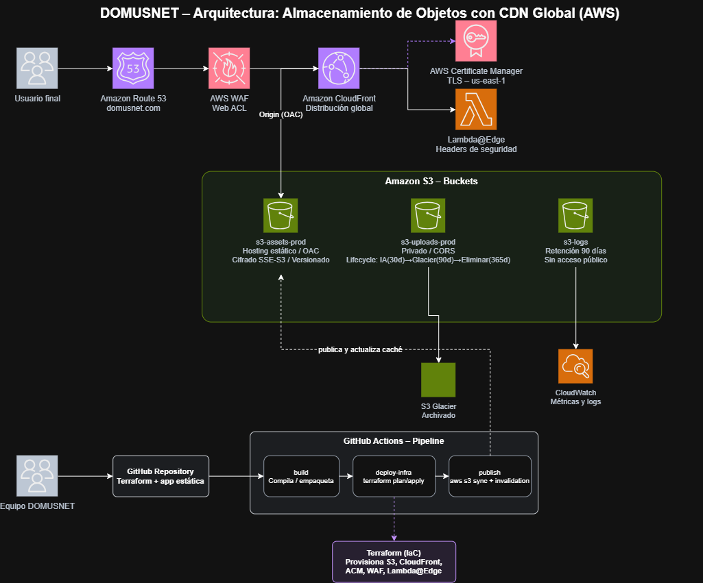

# 🌐 DOMUSNET — Plataforma de Almacenamiento de Objetos con CDN Global y Ciclo de Vida en AWS

> **Infraestructura para Ti** · Proyecto 04

Plataforma de hosting estático y distribución de activos digitales sobre **AWS**, desplegada 100 % como código con **Terraform**. Combina almacenamiento durable en S3, distribución global con CloudFront, seguridad en el borde (WAF, ACM, Lambda@Edge) y optimización de costos mediante políticas de ciclo de vida.


---

## 📋 Tabla de contenidos

- [Descripción general](#-descripción-general)
- [Objetivos](#-objetivos)
- [Arquitectura](#-arquitectura)
- [Componentes](#-componentes)
- [Flujo de la solicitud](#-flujo-de-la-solicitud)
- [Decisiones de diseño](#-decisiones-de-diseño)
- [Requisitos técnicos](#-requisitos-técnicos)
- [Estructura del repositorio](#-estructura-del-repositorio)
- [Variables de entorno](#-variables-de-entorno)
- [Uso rápido](#-uso-rápido)
- [Automatización con GitHub Actions](#automatización-con-github-actions)
- [Riesgos y mitigación](#-riesgos-y-mitigación)
- [Notas sobre el destroy](#-notas-sobre-el-destroy)
- [Equipo](#-equipo)

---

## 📖 Descripción general

| | |
|---|---|
| **Proyecto** | Plataforma de Almacenamiento de Objetos con CDN Global y Ciclo de Vida en AWS |
| **Plataforma cloud** | Amazon Web Services (AWS) |
| **Dificultad** | Intermedio |
| **Caso de uso** | Distribución de contenido estático y archivos de usuarios, con optimización de costos por ciclo de vida y hardening de seguridad en el borde |
| **Dominio** | `app.domusnet.uk` (delegado desde Cloudflare a Route 53) |

La plataforma separa tres tipos de datos, cada uno en su propio bucket S3:

| Tipo de dato | Bucket | Acceso |
|---|---|---|
| Activos de la aplicación | `domusnet-assets-prod-<account_id>` | Servido públicamente **solo vía CDN** |
| Archivos subidos por usuarios | `domusnet-uploads-prod-<account_id>` | Privado, con ciclo de vida |
| Logs de acceso | `domusnet-logs-prod-<account_id>` | Privado, retención de 90 días |

---

## 🎯 Objetivos

### General
Diseñar, construir y automatizar mediante Infraestructura como Código una plataforma de almacenamiento de objetos con distribución global de contenido en AWS, aplicando buenas prácticas de seguridad, optimización de costos y despliegue continuo.

### Específicos
- [x] Configurar buckets S3 con mínimo privilegio, cifrado en reposo y versionado.
- [x] Configurar CloudFront con **Origin Access Control (OAC)** para eliminar el acceso público directo al origen.
- [x] Solicitar, validar y asociar certificados TLS con **ACM** para un dominio personalizado bajo HTTPS.
- [x] Implementar ciclo de vida en S3: `Standard → Standard-IA → Glacier → eliminación`.
- [x] Desarrollar y desplegar una función **Lambda@Edge** que inyecte cabeceras HTTP de seguridad.
- [x] Construir un pipeline CI/CD que publique contenido e invalide la caché del CDN.
- [ ] Documentar arquitectura, costos y métricas de desempeño.

---

## 🏗️ Arquitectura

El diagrama de arquitectura está disponible como imagen y como archivo editable compatible con [diagrams.net](https://app.diagrams.net):



[Abrir o editar el diagrama](image/DOMUSNET_Arquitectura.drawio).

> El dominio publicado por la configuración actual es `app.domusnet.uk`, delegado desde Cloudflare a Route 53.

El flujo de DNS resuelve así:

```
Cloudflare (solo registros NS de delegación para "app")
      ↓
Route 53 (zona app.domusnet.uk, alias A/AAAA → CloudFront)
      ↓
WAF (Web ACL scope CLOUDFRONT)
      ↓
CloudFront (distribución global, origen S3 vía OAC)
      ↓
Lambda@Edge (viewer-response: cabeceras de seguridad)
      ↓
S3 assets (origen privado, sin acceso público directo)
```

---

## 🧩 Componentes

| Componente | Función | Configuración clave |
|---|---|---|
| **Cloudflare** | Gestión del dominio raíz `domusnet.uk` y registros NS de delegación | 4 registros `NS` para `app.domusnet.uk` apuntando a Route 53 |
| **Route 53** | Zona alojada autoritativa para `app.domusnet.uk` | Registros `A` y `AAAA` alias hacia CloudFront |
| **AWS WAF** | Filtrado de tráfico malicioso en el borde | Web ACL scope `CLOUDFRONT`, reglas OWASP Common RuleSet + rate limit 2000 req/IP |
| **CloudFront** | CDN global | Origen S3 vía OAC, TTL 86400 s para assets, sin caché para `index.html`, certificado ACM, logging a S3 |
| **ACM** | Certificado TLS | Región `us-east-1`, validación por DNS |
| **Lambda@Edge** | Hardening de cabeceras HTTP | Node.js 20.x, trigger `viewer-response`, inyecta HSTS, X-Content-Type-Options, X-Frame-Options, Referrer-Policy, Content-Security-Policy |
| **S3 — assets** | Origen del hosting estático | OAC, cifrado SSE-S3, versionado, Block Public Access, política de bucket restringida a CloudFront |
| **S3 — uploads** | Archivos de usuario | Privado, CORS, lifecycle: Standard → IA (30 d) → Glacier (90 d) → eliminación (365 d) |
| **S3 — logs** | Logs de CloudFront | Retención 90 días, sin acceso público, `log-delivery-write` ACL |
| **Terraform** | Aprovisionamiento declarativo | Módulos por servicio, backend S3 con `use_lockfile`, región `us-east-1` |

---

## 🔄 Flujo de la solicitud

1. El usuario resuelve `app.domusnet.uk`.
2. Cloudflare responde con los registros `NS` de Route 53 (delegación del subdominio).
3. Route 53 devuelve un registro alias `A`/`AAAA` hacia la distribución de CloudFront.
4. La solicitud pasa por **AWS WAF** (reglas OWASP Top 10 + limitación de tasa).
5. **CloudFront** responde desde el edge más cercano; si no hay caché, obtiene el objeto del origen vía **OAC** sin exponer el bucket S3 públicamente.
6. **Lambda@Edge** (`viewer-response`) inyecta las cabeceras de seguridad:
   - `Strict-Transport-Security`
   - `X-Content-Type-Options`
   - `X-Frame-Options`
   - `Referrer-Policy`
   - `Content-Security-Policy`
7. El certificado de **ACM** (`us-east-1`) garantiza que todo el tráfico viaje por HTTPS.
8. Los archivos de usuarios se guardan en `s3-uploads-prod` y transicionan automáticamente a clases más económicas.
9. Los logs de CloudFront llegan a `s3-logs` y alimentan métricas en **CloudWatch**.

---

## 🧠 Decisiones de diseño

- **Buckets separados por tipo de dato:** evita que una política de acceso o de ciclo de vida afecte a otro caso de uso y facilita auditar permisos.
- **OAC en lugar de acceso público:** todo el tráfico pasa por CloudFront, centralizando caché, TLS y seguridad de borde.
- **Lambda@Edge en `viewer-response`:** garantiza que las cabeceras se apliquen tanto a respuestas cacheadas como a las del origen.
- **Ciclo de vida en 3 fases:** IA a los 30 días y Glacier a los 90 balancea costo con acceso ocasional.
- **Todo vía Terraform:** infraestructura versionada, revisable en pull requests y reproducible en otra cuenta o entorno.
- **Delegación de subdominio vía Cloudflare:** como el dominio raíz (`domusnet.uk`) está registrado en Cloudflare Registrar (que bloquea cambios de NS del apex), se delega solo `app.domusnet.uk` a Route 53 mediante registros `NS` creados automáticamente por Terraform con el provider de Cloudflare.

---

## 🛠️ Requisitos técnicos

| Requisito | Detalle |
|---|---|
| **Cuenta AWS** | Permisos administrativos para IAM, S3, CloudFront, Lambda, ACM, Route 53 y WAF |
| **Dominio** | `domusnet.uk` en Cloudflare Registrar; subdominio `app` delegado a Route 53 |
| **Terraform** | CLI `>= 1.6`; backend remoto S3 con `use_lockfile` |
| **Cloudflare** | API Token con permiso `DNS:Edit` sobre la zona `domusnet.uk` |
| **Node.js** | Desarrollo de la función Lambda@Edge |
| **Pruebas** | [securityheaders.com](https://securityheaders.com) para validar cabeceras |

---

## 📁 Estructura del repositorio

```
.
├── .env.example                  # Template de variables de entorno (no subirse)
├── .gitignore                    # Ignora .env, .terraform, *.tfstate, etc.
├── .github/
│   └── workflows/
│       ├── deploy-site.yml       # Publicación de app/ en S3 e invalidación CloudFront
│       └── terraform.yml         # Validación, plan y apply protegido de Terraform
├── backend.tf                    # Backend remoto S3 (bucket domusnet-tfstate-130841270595)
├── main.tf                       # Orquestador de módulos
├── outputs.tf                    # Salidas de Terraform
├── providers.tf                  # Proveedores AWS y Cloudflare
├── terraform.tfvars              # Valores de variables (incluye Cloudflare zone_id)
├── variables.tf                  # Definición de variables de entrada
├── versions.tf                   # Versiones de proveedores (AWS, archive, cloudflare)
├── app/
│   ├── index.html                # Sitio estático de prueba
│   └── error.html                # Página de error personalizada
├── lambda/
│   └── edge-headers/
│       └── index.js              # Lambda@Edge: inyección de cabeceras de seguridad
├── envs/
│   └── prod.tfvars               # Archivo de entorno (actualmente sin variables, todo en terraform.tfvars)
├── modules/
│   ├── acm/                      # Certificado TLS (us-east-1, validación DNS)
│   ├── cloudflare-delegation/    # Registros NS en Cloudflare (delegación de app.domusnet.uk)
│   ├── cloudfront/               # Distribución CDN, OAC, políticas de caché, logging
│   ├── lambda-edge/              # Función Lambda@Edge (Node.js 20.x, viewer-response)
│   ├── route53/                  # Zonas alojadas (app.domusnet.uk + apex documental)
│   ├── s3/                       # 3 buckets (assets, uploads, logs) con lifecycle, CORS, SSE, versionado
│   └── waf/                      # Web ACL scope CLOUDFRONT (OWASP + rate limit)
└── image/
    ├── DOMUSNET_Arquitectura.drawio      # Diagrama editable
    └── DOMUSNET_Arquitectura.drawio.png  # Vista previa del diagrama
```

---

## 🔐 Variables de entorno

Para ejecutar Terraform localmente necesitas el perfil AWS CLI `DomusnetCol` y un token de Cloudflare con permiso `DNS:Edit` sobre la zona `domusnet.uk`. No guardes el token en el repositorio ni lo compartas en logs. En PowerShell puedes introducirlo sin que se muestre en pantalla:

```powershell
$env:AWS_PROFILE = "DomusnetCol"
$env:AWS_REGION = "us-east-1"
$secureToken = Read-Host "Token de API de Cloudflare" -AsSecureString
$env:TF_VAR_cloudflare_api_token = [System.Net.NetworkCredential]::new("", $secureToken).Password
```

`.env.example` es solo una plantilla: Terraform no carga automáticamente un archivo `.env`. Si eliges usar uno, mantenlo ignorado por Git y carga sus valores en el entorno antes de invocar Terraform.

---

## 🚀 Uso rápido

```powershell
# 1. Clonar el repositorio
git clone https://github.com/ISCOUTB/Plataforma-de-Almacenamiento-de-Objetos-con-CDN-Global-y-Ciclo-de-Vida-en-AWS.git
cd Plataforma-de-Almacenamiento-de-Objetos-con-CDN-Global-y-Ciclo-de-Vida-en-AWS

# 2. Seleccionar el perfil AWS local y región
$env:AWS_PROFILE = "DomusnetCol"
$env:AWS_REGION = "us-east-1"

# 3. Configurar el token de Cloudflare sin mostrarlo en pantalla
$secureToken = Read-Host "Token de API de Cloudflare" -AsSecureString
$env:TF_VAR_cloudflare_api_token = [System.Net.NetworkCredential]::new("", $secureToken).Password

# 4. Inicializar Terraform localmente (GitHub Actions usa OIDC)
terraform init -reconfigure -backend-config="profile=DomusnetCol"

# 5. Revisar los cambios
terraform plan

# 6. Aplicar la infraestructura
terraform apply
```

> **Nota sobre DNS:** Terraform crea los registros `NS` en Cloudflare para `app.domusnet.uk`. La propagación DNS y la validación del certificado ACM pueden tardar. El despliegue incluye Route 53, ACM, CloudFront, WAF, Lambda@Edge y los buckets S3.

### Publicar contenido estático (despliegue manual del sitio)

Una vez la infraestructura está creada:

```powershell
# Subir archivos al bucket de assets (privado, solo accesible vía CloudFront)
aws s3 sync app/ s3://domusnet-assets-prod-<account_id> --delete --profile DomusnetCol

# Invalidar caché de CloudFront
aws cloudfront create-invalidation --distribution-id <ID_DISTRIBUCION> --paths "/*" --profile DomusnetCol
```

### Automatización con GitHub Actions

La automatización se divide en dos workflows:

| Workflow | Cuándo se ejecuta | Qué hace |
|---|---|---|
| `deploy-site.yml` | Cada push a `master` o ejecución manual (`workflow_dispatch`) | Sincroniza `app/` al bucket de assets con `aws s3 sync --delete` e invalida `/*` en CloudFront. Se omite si faltan las variables del bucket o la distribución. |
| `terraform.yml` | Push a `master` que modifica archivos Terraform, variables de Terraform, el lockfile, `lambda/` o el propio workflow; también permite ejecución manual | Ejecuta `terraform fmt`, `init`, `validate` y `plan`. El job `apply` vuelve a crear un plan actualizado y requiere la aprobación del entorno de producción. |
| `terraform-destroy.yml` | Solo ejecución manual desde `master` | Valida la frase de confirmación, publica un plan de destroy para revisión y requiere aprobación del entorno protegido antes de destruir. |

#### Configuración de GitHub

En **Settings → Secrets and variables → Actions**, configura estas **Repository variables**:

| Variable | Valor |
|---|---|
| `AWS_REGION` | `us-east-1` |
| `AWS_SITE_PUBLISH_ROLE_ARN` | ARN del rol OIDC `domusnet-site-publish` |
| `AWS_TERRAFORM_PLAN_ROLE_ARN` | ARN del rol OIDC `domusnet-terraform-plan` |
| `AWS_TERRAFORM_APPLY_ROLE_ARN` | ARN del rol OIDC `domusnet-terraform-apply` |
| `AWS_TERRAFORM_DESTROY_ROLE_ARN` | `arn:aws:iam::130841270595:role/domusnet-terraform-destroy` |
| `S3_ASSETS_BUCKET` | Nombre del bucket de assets, por ejemplo `domusnet-assets-prod-<account_id>` |
| `CLOUDFRONT_DISTRIBUTION_ID` | ID de la distribución CloudFront |

Guarda `CLOUDFLARE_API_TOKEN` como **Repository secret**. No lo pongas en variables ni únicamente en el entorno de aprobación: el job `plan` necesita leerlo y no está asociado al entorno `infra-production`.

Configura el entorno **`infra-production`** para limitar despliegues a `master` y requerir la aprobación de un revisor. Terraform y la publicación se autentican en AWS mediante OIDC; no se almacenan claves AWS permanentes en GitHub. Los roles deben confiar únicamente en este repositorio y tener permisos separados para planificar, aplicar o publicar.

Después del primer `apply`, copia `assets_bucket` y `cloudfront_distribution_id` del resumen del job de Terraform a las variables `S3_ASSETS_BUCKET` y `CLOUDFRONT_DISTRIBUTION_ID`. Puedes iniciar manualmente cada workflow desde **Actions → seleccionar workflow → Run workflow**, usando la rama `master`.

El workflow de destroy también es manual y exclusivo de `master`: debes escribir `DESTROY`, revisar el plan publicado en el resumen y luego aprobar el job protegido `infra-production`. Usa un rol OIDC separado del rol de apply.

> **Importante:** `aws s3 sync --delete` elimina del bucket los objetos que ya no están en `app/`. No uses ese mecanismo para publicar datos de usuarios.

---

## ⚠️ Riesgos y mitigación

| Riesgo | Impacto | Mitigación |
|---|---|---|
| Costos inesperados en AWS | Medio | AWS Budgets y alarmas; revisión semanal; capa gratuita |
| Certificado ACM fuera de `us-east-1` | Alto | Región fija `us-east-1` en todos los recursos (CloudFront, WAF, Lambda@Edge requieren us-east-1) |
| Pérdida de datos por errores de lifecycle | Alto | Versiónado activo en buckets; pruebas en staging |
| Lambda@Edge no se destruye | Medio | Las réplicas en edge locations impiden borrar la función inmediatamente; esperar a que CloudFront las limpie |
| Retrasos en validación de dominio/DNS | Medio | Delegar `app.domusnet.uk` desde Cloudflare desde la semana 1 |
| Eliminación de datos al destruir | Alto | Revisar `terraform plan -destroy` y respaldar los buckets antes de confirmar |

---

## 👥 Equipo

**DOMUSNET** — 4 integrantes. Las decisiones de diseño se validan en revisiones semanales y todo el código se integra mediante pull requests revisados por al menos un compañero distinto al autor.

| Integrante | Rol | Componentes a cargo |
|---|---|---|
| **Diego Rosales** | Cloud & IaC | S3 (buckets, políticas, lifecycle), estructura del repositorio Terraform |
| **Sebastian Torres** | DevOps / CI-CD | Pipeline GitHub Actions, sincronización S3, invalidación de caché |
| **Jose Chima** | Seguridad Cloud | CloudFront, ACM, WAF, Lambda@Edge, cabeceras HTTP |
| **Ellen Ordoñez** | QA, Costos y Documentación | CloudWatch, securityheaders.com, informes y documentación |

---

## 🗂️ Estado de entregas

| Entrega | Contenido | Estado |
|---|---|---|
| **Entrega 1** | Propuesta de proyecto, diagrama de arquitectura, roles y plan semanal | ✅ Completado |
| **Entrega 2** | Código Terraform de S3 (buckets, políticas, cifrado, versionado, lifecycle) | ✅ Implementado |
| **Entrega 3** | Terraform de CloudFront, ACM, Route 53, WAF, delegación Cloudflare, Lambda@Edge | ✅ Implementado |
| **Entrega final** | Pipeline CI/CD y guía de operación implementados; análisis de costos, métricas y presentación | 🟡 En progreso |

---

## 🔧 Notas sobre el destroy

`terraform destroy` elimina la infraestructura administrada por Terraform y deja el sitio fuera de servicio. Antes de empezar, espera a que terminen los workflows activos y evita hacer push a `master` durante la operación.

> **Pérdida irreversible de datos:** los tres buckets tienen `force_destroy = true`. El destroy puede borrar todos sus objetos y versiones, incluidos archivos subidos y logs. Haz y verifica cualquier respaldo que necesites antes de continuar.

### Destruir desde GitHub Actions

Configura la variable de repositorio `AWS_TERRAFORM_DESTROY_ROLE_ARN` con el ARN `arn:aws:iam::130841270595:role/domusnet-terraform-destroy` y asegúrate de que el secreto `CLOUDFLARE_API_TOKEN` contenga un token activo con permiso DNS:Edit sobre `domusnet.uk`.

En **Actions → Destroy Terraform infrastructure → Run workflow**, selecciona `master` y escribe `DESTROY`. Revisa el plan del job `Review destroy plan`. Para continuar, un revisor debe aprobar `Destroy approved infrastructure` en el entorno `infra-production`; sin esa aprobación el destroy no se ejecuta.

El workflow crea un plan nuevo después de la aprobación y aplica ese plan. Si el plan falla por credenciales de Cloudflare o AWS, no apruebes ni intentes eliminar recursos manualmente; corrige la credencial o permiso y vuelve a ejecutar.

### Destruir desde PowerShell

Ejecuta estos pasos desde la raíz del repositorio en PowerShell. El perfil `DomusnetCol` debe tener permisos suficientes para eliminar todos los recursos, incluidas las zonas de Route 53; el rol de apply de GitHub Actions no está diseñado para borrar toda la infraestructura.

```powershell
# Usa el perfil AWS local y la región del despliegue
$env:AWS_PROFILE = "DomusnetCol"
$env:AWS_REGION = "us-east-1"

# Terraform también necesita el token de Cloudflare para gestionar sus registros se debe escribor a mano letra por letra 
$secureToken = Read-Host "Token de API de Cloudflare" -AsSecureString
$env:TF_VAR_cloudflare_api_token = [System.Net.NetworkCredential]::new("", $secureToken).Password

# Conecta el backend remoto existente; no crea un estado local nuevo
terraform init -reconfigure -backend-config="profile=DomusnetCol"

# Revisa cuidadosamente todos los recursos y datos que se eliminarán
terraform plan -destroy

# Genera el plan y pide confirmación interactiva; escribe yes solo si lo aprobaste
terraform destroy
```

El bucket remoto de estado `domusnet-tfstate-130841270595` no forma parte del destroy y permanecerá en AWS. Consérvalo mientras necesites el estado de Terraform; eliminarlo manualmente puede impedir la recuperación o gestión de la infraestructura. Los roles IAM de GitHub también se crearon fuera de Terraform y permanecerán, pero no tienen un costo por hora.

CloudFront y las réplicas de Lambda@Edge pueden tardar varios minutos en deshabilitarse y eliminarse. Si el destroy normal se bloquea por la eliminación de Lambda@Edge, espera a que CloudFront termine de propagarse. Como alternativa excepcional, ejecuta:

```powershell
terraform destroy -target=module.cloudfront
terraform destroy
```

`-target` solo debe usarse para resolver ese bloqueo; el destroy completo final sigue siendo necesario.

---

<p align="center"><b>DOMUSNET</b> · Infraestructura para Ti</p>
